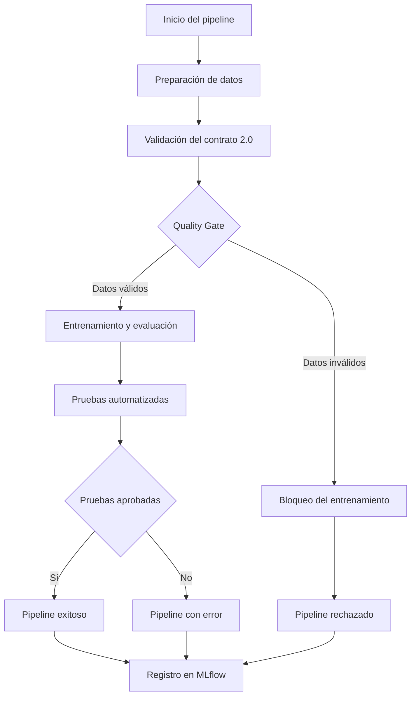

# Actividad 2.1 – Estandarización de Pipelines y Control de Calidad de Datos

**Universidad Santo Tomás**  
**Especialización en Ciencia de Datos**  
**Asignatura:** Seminario de Grado II  
**Caso de estudio:** Clasificación de especies de flores Iris  
**Tecnologías:** Python, scikit-learn, MLflow, pytest y Git.

---

## 1. Descripción del proyecto

Esta actividad da continuidad al trabajo desarrollado en la Actividad 1.1,
en la cual se implementó una línea base reproducible mediante un modelo
Random Forest y el seguimiento de experimentos con MLflow.

En esta segunda actividad se amplía la solución mediante la
estandarización del pipeline, la separación de responsabilidades
en módulos independientes y la incorporación de controles de calidad
que permiten verificar los datos antes de iniciar el entrenamiento.

El propósito es contar con un proceso automatizado, reproducible y
trazable, capaz de detener su ejecución cuando los datos no cumplen
las condiciones establecidas en el contrato de calidad.

---

## 2. Objetivos

### Objetivo general

Implementar un pipeline automatizado de Machine Learning que integre
la preparación de datos, la validación de calidad, el entrenamiento
del modelo y las pruebas automatizadas, garantizando la trazabilidad
de sus ejecuciones mediante MLflow.

### Objetivos específicos

- Organizar el pipeline mediante módulos independientes.
- Ampliar el contrato de datos a la versión 2.0.
- Implementar reglas de validación para registros y etiquetas.
- Incorporar un Quality Gate que bloquee el entrenamiento
  cuando se detecten incumplimientos.
- Verificar el comportamiento del sistema mediante pruebas automatizadas.
- Registrar métricas, estados y evidencias de ejecución en MLflow.
- Facilitar la reproducción del proyecto mediante documentación
  y dependencias versionadas.

---

## 3. Conjunto de datos

Se utiliza el dataset Iris, disponible en la biblioteca scikit-learn,
manteniendo el mismo caso de estudio de la Actividad 1.1.

El conjunto contiene 150 registros, cuatro características numéricas
y tres clases correspondientes a especies de flores Iris.

| Variable | Descripción | Tipo |
|---|---|---|
| sepal_length | Longitud del sépalo en cm | Numérico |
| sepal_width | Ancho del sépalo en cm | Numérico |
| petal_length | Longitud del pétalo en cm | Numérico |
| petal_width | Ancho del pétalo en cm | Numérico |
| target | Especie de la flor | Entero |

Las clases permitidas para la variable objetivo son:

- 0: Iris setosa.
- 1: Iris versicolor.
- 2: Iris virginica.

No es necesario descargar archivos CSV externos, debido a que
el conjunto de datos se carga directamente desde scikit-learn.

---

## 4. Estructura del proyecto

```text
Actividad_2_1_Pipeline/
│
├── .gitignore
├── data_contract.json
├── prepare.py
├── validate_data.py
├── train.py
├── tracking.py
├── test_pipeline.py
├── run_pipeline.py
├── requirements.txt
├── README.md
├── README_Actividad_1_1.md
└── README_Actividad_2_1.md
```

### Responsabilidad de los archivos

| Archivo | Función |
|---|---|
| prepare.py | Carga y prepara el dataset Iris y genera los escenarios de prueba. |
| data_contract.json | Define las reglas de calidad de los datos. |
| validate_data.py | Valida registros, etiquetas y condiciones del dataset. |
| train.py | Entrena y evalúa el modelo Random Forest. |
| tracking.py | Gestiona la trazabilidad de las ejecuciones mediante MLflow. |
| test_pipeline.py | Contiene las 17 pruebas automatizadas. |
| run_pipeline.py | Coordina la ejecución de las etapas del pipeline. |
| requirements.txt | Define las versiones de las dependencias. |
| .gitignore | Excluye archivos temporales y recursos locales del repositorio. |

---

## 5. Arquitectura del pipeline

El pipeline se encuentra organizado en cuatro etapas principales:

1. Preparación de datos.
2. Validación y control de calidad.
3. Entrenamiento y evaluación.
4. Pruebas automatizadas.

La ejecución se coordina desde el archivo run_pipeline.py.



La validación funciona como una condición obligatoria para continuar
con el entrenamiento. Si los datos no cumplen el contrato, el proceso
se detiene y registra el motivo del rechazo.

---

## 6. Requisitos del entorno

El proyecto fue desarrollado y ejecutado utilizando:

| Componente | Versión |
|---|---|
| Python | 3.13.14 |
| MLflow | 3.17.2 |
| scikit-learn | 1.9.1 |
| pytest | 9.2.0 |
| Sistema operativo | Windows |
| Editor de código | Visual Studio Code |

Las dependencias directas se encuentran definidas en el archivo
requirements.txt con sus respectivas versiones.

---

## 7. Instalación y configuración

### 7.1. Abrir el proyecto

Abrir la carpeta del proyecto desde Visual Studio Code y utilizar
una terminal PowerShell ubicada en la raíz del repositorio.

### 7.2. Crear el entorno virtual

```powershell
python -m venv venv
```

### 7.3. Activar el entorno virtual

```powershell
.\venv\Scripts\Activate.ps1
```

Si PowerShell bloquea la ejecución del script de activación,
habilitar los permisos únicamente para la sesión actual:

```powershell
Set-ExecutionPolicy -Scope Process -ExecutionPolicy RemoteSigned
```

Posteriormente, activar nuevamente el entorno virtual.

### 7.4. Instalar las dependencias

```powershell
python -m pip install -r requirements.txt
```

---

## 8. Contrato de datos versión 2.0

El archivo data_contract.json establece las condiciones que deben
cumplir los datos antes de ser utilizados por el modelo.

Las reglas implementadas permiten verificar:

- Existencia de los campos obligatorios.
- Ausencia de campos adicionales no permitidos.
- Tipos de datos numéricos.
- Ausencia de valores nulos.
- Exclusión de valores booleanos.
- Ausencia de valores NaN e infinitos.
- Cumplimiento de los rangos mínimos y máximos.
- Existencia de registros en el dataset.
- Correspondencia entre registros y etiquetas.
- Tipo de dato y clases permitidas para las etiquetas.

Para las cuatro características numéricas se establece un rango
operativo de 0.1 a 10.0 centímetros.

Estos límites corresponden a las reglas definidas para el ejercicio
académico y no representan límites botánicos universales.

### Ejemplo de registro válido

```json
{
    "sepal_length": 5.1,
    "sepal_width": 3.5,
    "petal_length": 1.4,
    "petal_width": 0.2
}
```

### Ejemplo de registro inválido

```json
{
    "sepal_length": null,
    "sepal_width": "abc",
    "petal_length": -2.0,
    "petal_width": 0.2
}
```

El segundo registro presenta tres incumplimientos:

- Un valor nulo.
- Un tipo de dato incorrecto.
- Un valor inferior al mínimo permitido.

---

## 9. Implementación del Quality Gate

El Quality Gate es el mecanismo encargado de decidir si los datos
pueden continuar hacia la etapa de entrenamiento.

Para aprobar la validación, los datos deben cumplir las condiciones
establecidas en el contrato.

El pipeline no continúa cuando se detectan incumplimientos,
aunque la mayoría de los registros sean válidos.

| Condición | Comportamiento |
|---|---|
| Validación aprobada | Continúa hacia el entrenamiento. |
| Validación rechazada | Bloquea el entrenamiento. |
| Ejecución exitosa | Código de salida 0. |
| Rechazo por calidad | Código de salida 1. |

Esta implementación sigue el principio Fail Fast, que consiste
en detectar los errores de manera temprana y evitar que se
propaguen hacia las etapas posteriores.

---

## 10. Ejecución del pipeline

El proyecto permite seleccionar dos escenarios mediante argumentos
desde la terminal.

### 10.1. Escenario con datos válidos

```powershell
python run_pipeline.py --escenario valido
```

Este escenario utiliza el dataset Iris sin introducir errores
controlados y ejecuta las cuatro etapas del pipeline.

Resultados obtenidos:

| Indicador | Resultado |
|---|---:|
| Total de registros | 150 |
| Registros válidos | 150 |
| Registros inválidos | 0 |
| Etiquetas inválidas | 0 |
| Calidad de registros | 100 % |
| Total de errores | 0 |
| Pruebas aprobadas | 17 de 17 |
| Código de salida | 0 |
| Duración total observada | 22.70 segundos |

Estado final: EXITOSO.

### 10.2. Escenario con datos inválidos

```powershell
python run_pipeline.py --escenario invalido
```

En este escenario se introducen tres errores controlados en un
registro del dataset para verificar el funcionamiento del Quality Gate.

Resultados obtenidos:

| Indicador | Resultado |
|---|---:|
| Total de registros | 150 |
| Registros válidos | 149 |
| Registros inválidos | 1 |
| Etiquetas inválidas | 0 |
| Calidad de registros | 99.33 % |
| Total de errores | 3 |
| Código de salida | 1 |
| Duración total observada | 3.63 segundos |

Estado final: RECHAZADO_POR_CALIDAD.

Aunque el porcentaje de registros válidos corresponde al 99.33 %,
el pipeline detiene su ejecución porque existe un registro que
incumple tres reglas del contrato.

El entrenamiento queda bloqueado y las pruebas posteriores
no se ejecutan dentro de este escenario.

### 10.3. Verificar el código de salida

Después de ejecutar cualquiera de los escenarios, se puede
consultar el código de salida desde PowerShell:

```powershell
$LASTEXITCODE
```

Los resultados esperados son:

- 0 para el escenario válido ejecutado correctamente.
- 1 para el escenario rechazado por calidad.

---

## 11. Entrenamiento y evaluación del modelo

Se utiliza un modelo Random Forest para realizar la clasificación
de las tres especies de flores Iris.

La distribución de los datos se realiza de la siguiente manera:

| Conjunto | Porcentaje | Registros |
|---|---:|---:|
| Entrenamiento | 80 % | 120 |
| Prueba | 20 % | 30 |
| Total | 100 % | 150 |

### Métricas obtenidas

| Métrica | Resultado |
|---|---:|
| Accuracy | 0.9333 |
| Precision macro | 0.9333 |
| Recall macro | 0.9333 |
| F1-score macro | 0.9333 |

El modelo obtuvo una exactitud del 93.33 %, correspondiente
a 28 clasificaciones correctas de las 30 muestras de prueba.

Las métricas macro permiten evaluar el comportamiento del modelo
considerando las clases con la misma importancia.

El propósito principal de esta actividad no es optimizar el modelo,
sino garantizar que su entrenamiento se realice únicamente cuando
los datos cumplen las condiciones de calidad establecidas.

---

## 12. Pruebas automatizadas

El archivo test_pipeline.py contiene 17 pruebas automatizadas
implementadas mediante unittest y ejecutadas con pytest.

| N.º | Caso de prueba | Resultado |
|---:|---|---|
| 1 | Registro válido | PASSED |
| 2 | Valores nulos | PASSED |
| 3 | Tipos incorrectos | PASSED |
| 4 | Valor inferior al mínimo | PASSED |
| 5 | Valor superior al máximo | PASSED |
| 6 | Campo obligatorio ausente | PASSED |
| 7 | Campo adicional no permitido | PASSED |
| 8 | Valores booleanos | PASSED |
| 9 | Valores NaN | PASSED |
| 10 | Valores infinitos | PASSED |
| 11 | Dataset vacío | PASSED |
| 12 | Correspondencia entre registros y etiquetas | PASSED |
| 13 | Etiqueta fuera de las clases permitidas | PASSED |
| 14 | Tipo incorrecto de etiqueta | PASSED |
| 15 | Dataset Iris válido completo | PASSED |
| 16 | Dataset con errores controlados | PASSED |
| 17 | Bloqueo del entrenamiento en el pipeline | PASSED |

Para ejecutar las pruebas de manera independiente:

```powershell
python -m pytest test_pipeline.py -v
```

Resultado observado:

```text
17 passed in 4.14s
```

Las pruebas permiten verificar tanto la aceptación de datos
correctos como el rechazo de entradas que incumplen el contrato.

La prueba número 17 verifica específicamente el comportamiento
del pipeline frente al bloqueo del entrenamiento.

---

## 13. Trazabilidad de ejecuciones con MLflow

MLflow permite conservar el historial de ejecución del pipeline,
facilitando la consulta de resultados, métricas y evidencias.

El experimento correspondiente a esta actividad se denomina:

```text
Actividad_2_1_Control_Calidad
```

### 13.1. Iniciar la interfaz de MLflow

Abrir una segunda terminal desde la carpeta del proyecto,
activar el entorno virtual y ejecutar:

```powershell
mlflow ui --backend-store-uri sqlite:///mlflow.db
```

Ingresar desde el navegador a:

http://127.0.0.1:5000

Seleccionar el experimento Actividad_2_1_Control_Calidad.

### 13.2. Ejecuciones finales registradas

| Escenario | Nombre de ejecución | Estado |
|---|---|---|
| Válido | Pipeline_Datos_Validos | Exitoso |
| Inválido | Pipeline_Datos_Invalidos | Rechazado |

Identificadores de las ejecuciones finales:

**Escenario válido:**

```text
e06a5367cce842e1b90cca8fa4ca3cd9
```

**Escenario inválido:**

```text
d9eb674ad9164ebd852c62ccbb33e5eb
```

Estos identificadores corresponden a las ejecuciones realizadas
en el entorno local de desarrollo. Una nueva ejecución generará
un identificador diferente.

### 13.3. Artefactos registrados

Para el escenario válido:

```text
calidad/
├── data_contract.json
└── reporte_calidad.json

pruebas/
└── resultados_pytest.txt
```

Para el escenario inválido:

```text
calidad/
├── data_contract.json
└── reporte_calidad.json
```

El reporte de calidad permite consultar los registros evaluados,
los incumplimientos detectados y el resultado de la validación.

El archivo resultados_pytest.txt conserva la evidencia de las
17 pruebas automatizadas ejecutadas en el escenario válido.

En el escenario inválido no se genera este último artefacto,
debido a que el Quality Gate detiene el proceso antes de llegar
a la etapa de pruebas posteriores.

---

## 14. Comparación de escenarios

| Indicador | Datos válidos | Datos inválidos |
|---|---:|---:|
| Registros evaluados | 150 | 150 |
| Registros válidos | 150 | 149 |
| Registros inválidos | 0 | 1 |
| Errores detectados | 0 | 3 |
| Calidad de registros | 100 % | 99.33 % |
| Quality Gate | Aprobado | Rechazado |
| Entrenamiento | Completado | Bloqueado |
| Pruebas posteriores | 17 aprobadas | No ejecutadas |
| Código de salida | 0 | 1 |
| Estado final | Exitoso | Rechazado por calidad |

La comparación demuestra que el pipeline responde de manera
diferenciada según el cumplimiento del contrato.

Cuando los datos son correctos, el proceso continúa hasta
completar el entrenamiento y las pruebas automatizadas.

Cuando se detectan incumplimientos, el proceso se detiene
antes de entrenar el modelo y conserva la evidencia del rechazo.

---

## 15. Evolución respecto a la Actividad 1.1

| Componente | Actividad 1.1 | Actividad 2.1 |
|---|---|---|
| Arquitectura | Pipeline inicial | Pipeline modular |
| Contrato de datos | Versión inicial | Versión 2.0 |
| Preparación | Integrada al pipeline | Módulo independiente |
| Validación | Reglas de entrada | Registros, etiquetas y dataset |
| Pruebas automatizadas | 5 | 17 |
| Escenarios | Validación inicial | Válido e inválido |
| Control de calidad | Validación previa | Quality Gate con códigos de salida |
| Evaluación | Accuracy | Accuracy, Precision, Recall y F1 macro |
| Trazabilidad | Experimentos del modelo | Ejecuciones integrales del pipeline |
| Dependencias | Sin versiones fijas | Versiones definidas |

La segunda actividad fortalece la solución inicial mediante
la incorporación de controles adicionales, una estructura modular
y una mayor cobertura de pruebas.

El número de pruebas pasó de 5 a 17, lo que representa un
incremento del 240 % en la cantidad de casos automatizados.

---

## 16. Reproducibilidad y versionamiento

El proyecto utiliza Git para gestionar los cambios realizados
sobre los archivos fuente.

El archivo .gitignore excluye recursos generados localmente,
entre ellos:

- Entornos virtuales.
- Archivos temporales de Python.
- Caché de pytest.
- Base de datos local de MLflow.
- Directorios de artefactos de MLflow.
- Copias de seguridad.

Estos recursos pueden generarse nuevamente mediante la ejecución
del proyecto.

Los resultados históricos almacenados localmente en MLflow no
se publican automáticamente en GitHub.

La documentación de la Actividad 1.1 se conserva como referencia
del trabajo previo y de la evolución del proyecto.

---

## 17. Alcance y limitaciones

- El proyecto se desarrolla utilizando el dataset Iris.
- Las reglas de calidad corresponden al contrato definido
  para este caso de estudio.
- Las pruebas automatizadas verifican los casos contemplados,
  pero no garantizan la detección de todos los posibles errores.
- Las métricas del modelo corresponden al conjunto de prueba
  utilizado durante la ejecución.
- Los tiempos de ejecución pueden variar según el equipo.
- El seguimiento de MLflow se realiza en un entorno local.
- El proyecto no contempla el despliegue del modelo en producción
  ni la monitorización continua de datos.

---

## 18. Conclusiones

El desarrollo de esta actividad permitió fortalecer el pipeline
implementado inicialmente, incorporando una estructura modular,
reglas de calidad y mecanismos de validación automatizada.

La ejecución de los dos escenarios permitió comprobar que el
pipeline continúa cuando los datos cumplen el contrato y bloquea
el entrenamiento cuando se presentan incumplimientos.

Las 17 pruebas automatizadas fueron superadas correctamente,
incluyendo la verificación del bloqueo del entrenamiento.

Por otra parte, MLflow permitió conservar la trazabilidad de las
ejecuciones y los artefactos asociados a cada escenario.

En conclusión, la calidad de un proyecto de Machine Learning
no depende únicamente del desempeño del modelo, sino también
de la confiabilidad de los datos, la reproducibilidad del proceso
y la capacidad de identificar errores antes de que afecten
las etapas posteriores.

---

## 19. Referencias técnicas

- Python: https://docs.python.org/3/
- scikit-learn: https://scikit-learn.org/stable/
- MLflow: https://mlflow.org/docs/latest/
- pytest: https://docs.pytest.org/
- Git: https://git-scm.com/doc

---

**Proyecto académico – Seminario de Grado II**

**Especialización en Ciencia de Datos – Universidad Santo Tomás**   