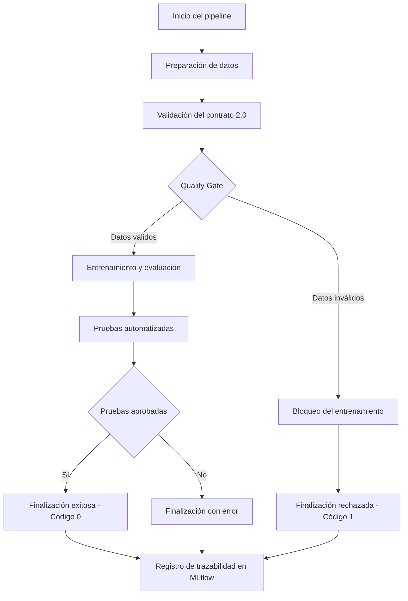

# Seminario de Grado II – Pipeline reproducible y control de calidad de datos

**Universidad Santo Tomás**  
**Especialización en Ciencia de Datos**  
**Asignatura:** Seminario de Grado II  
**Caso de estudio:** Clasificación de especies de flores Iris  
**Tecnologías:** Python, scikit-learn, MLflow, pytest y Git.

---

## 1. Descripción del proyecto

Este repositorio reúne el desarrollo de las actividades académicas de Seminario de Grado II, orientadas a la implementación de procesos de Machine Learning reproducibles, automatizados y trazables.

El proyecto utiliza el conjunto de datos Iris y un modelo de clasificación Random Forest. Su desarrollo parte de la implementación de una línea base reproducible y evoluciona hacia una arquitectura modular que incorpora controles de calidad, validaciones automatizadas y mecanismos de bloqueo del entrenamiento ante datos incorrectos.

El propósito es fortalecer la confiabilidad del proceso de Machine Learning, considerando no solamente el desempeño del modelo, sino también la calidad de los datos y la trazabilidad de cada ejecución.

---

## 2. Actividades desarrolladas

| Actividad | Descripción | Documentación |
|---|---|---|
| Actividad 1.1 | Implementación de Línea Base Reproducible y Trazabilidad de Experimentos | [Consultar documentación](README_Actividad_1_1.md) |
| Actividad 2.1 | Estandarización de Pipelines y Control de Calidad de Datos | [Consultar documentación](README_Actividad_2_1.md) |

La Actividad 2.1 da continuidad al trabajo realizado en la primera actividad, incorporando nuevos componentes y fortaleciendo los mecanismos de validación y automatización.

---

## 3. Evolución del proyecto

| Componente | Actividad 1.1 | Actividad 2.1 |
|---|---|---|
| Modelo | Random Forest | Random Forest |
| Dataset | Iris | Iris |
| Arquitectura | Pipeline inicial | Pipeline modular |
| Contrato de datos | Versión inicial | Versión 2.0 |
| Preparación de datos | Integrada al pipeline | Módulo independiente |
| Validación | Validación de entradas | Validación integral de registros y etiquetas |
| Pruebas automatizadas | 5 pruebas | 17 pruebas |
| Control de ejecución | Validación previa | Quality Gate y códigos de salida |
| Trazabilidad | MLflow | MLflow con seguimiento de calidad y ejecución |
| Dependencias | Configuración inicial | Versiones específicas |

---

## 4. Arquitectura actual del pipeline

El pipeline se encuentra organizado en etapas independientes que permiten separar responsabilidades y facilitar el mantenimiento del código.



MLflow acompaña el proceso de ejecución, permitiendo registrar los resultados y conservar las evidencias asociadas a cada escenario.

---

## 5. Estructura del repositorio

```text
seminario-grado-ii-ml-pipeline/
│
├── .gitignore
├── data_contract.json
├── prepare.py
├── validate_data.py
├── train.py
├── tracking.py
├── run_pipeline.py
├── test_pipeline.py
├── requirements.txt
├── README.md
├── README_Actividad_1_1.md
└── README_Actividad_2_1.md
```

### Responsabilidad de los archivos

| Archivo | Función |
|---|---|
| `prepare.py` | Preparación del dataset y generación de escenarios de ejecución. |
| `validate_data.py` | Validación de los registros y etiquetas según el contrato de datos. |
| `data_contract.json` | Definición de las reglas de calidad, versión 2.0. |
| `train.py` | Entrenamiento y evaluación del modelo Random Forest. |
| `tracking.py` | Gestión de la trazabilidad de las ejecuciones mediante MLflow. |
| `run_pipeline.py` | Orquestación de las etapas del pipeline. |
| `test_pipeline.py` | Ejecución de las 17 pruebas automatizadas. |
| `requirements.txt` | Dependencias necesarias para reproducir el proyecto. |
| `.gitignore` | Exclusión de archivos temporales y componentes locales. |

---

## 6. Tecnologías y versiones utilizadas

| Tecnología | Versión utilizada |
|---|---|
| Python | 3.13.14 |
| MLflow | 3.17.2 |
| scikit-learn | 1.9.1 |
| pytest | 9.2.0 |

El desarrollo se realizó utilizando Visual Studio Code, Windows PowerShell y Git como herramienta de control de versiones.

---

## 7. Instalación y configuración

Abrir el repositorio desde Visual Studio Code y ejecutar los siguientes comandos en una terminal PowerShell ubicada en la raíz del proyecto.

### Crear el entorno virtual

```powershell
python -m venv venv
```

### Activar el entorno virtual

```powershell
.\venv\Scripts\Activate.ps1
```

Si PowerShell restringe la ejecución del script, habilitar los permisos únicamente para la sesión actual:

```powershell
Set-ExecutionPolicy -Scope Process -ExecutionPolicy RemoteSigned
```

Posteriormente, activar nuevamente el entorno virtual.

### Instalar las dependencias

```powershell
python -m pip install -r requirements.txt
```

---

## 8. Ejecución del pipeline

La versión correspondiente a la Actividad 2.1 permite ejecutar dos escenarios para comprobar el comportamiento del control de calidad.

### Escenario válido

```powershell
python run_pipeline.py --escenario valido
```

Este escenario ejecuta las etapas de preparación, validación, entrenamiento, evaluación y pruebas automatizadas.

**Código de salida esperado:** 0.

### Escenario inválido

```powershell
python run_pipeline.py --escenario invalido
```

Este escenario introduce errores controlados en los datos para verificar que el Quality Gate detenga el proceso antes del entrenamiento.

**Código de salida esperado:** 1.

Para consultar el código de salida en PowerShell:

```powershell
$LASTEXITCODE
```

---

## 9. Resultados obtenidos

### Comparación de escenarios

| Indicador | Escenario válido | Escenario inválido |
|---|---:|---:|
| Total de registros | 150 | 150 |
| Registros válidos | 150 | 149 |
| Registros inválidos | 0 | 1 |
| Etiquetas inválidas | 0 | 0 |
| Calidad de registros | 100 % | 99,33 % |
| Errores detectados | 0 | 3 |
| Control de calidad | Aprobado | Rechazado |
| Entrenamiento | Completado | Bloqueado |
| Pruebas posteriores | 17 aprobadas | No ejecutadas |
| Código de salida | 0 | 1 |
| Estado final | Exitoso | Rechazado por calidad |

Aunque el escenario inválido presenta un porcentaje de calidad del 99,33 %, el pipeline bloquea el entrenamiento debido al incumplimiento de las reglas obligatorias del contrato.

Esto demuestra que la aprobación del control de calidad no depende únicamente de un porcentaje general, sino del cumplimiento de las condiciones establecidas.

### Desempeño del modelo

Los resultados obtenidos en la ejecución válida fueron:

| Métrica | Resultado |
|---|---:|
| Accuracy | 93,33 % |
| Precision macro | 93,33 % |
| Recall macro | 93,33 % |
| F1-score macro | 93,33 % |
| Muestras de entrenamiento | 120 |
| Muestras de prueba | 30 |

Estas métricas corresponden al conjunto de prueba de la ejecución realizada y no garantizan el mismo desempeño sobre datos futuros.

---

## 10. Pruebas automatizadas

El proyecto cuenta con 17 pruebas automatizadas que permiten verificar las reglas del contrato de datos y el comportamiento del pipeline.

Para ejecutarlas de manera independiente:

```powershell
python -m pytest test_pipeline.py -v
```

Resultado obtenido:

```text
17 passed
```

Las pruebas incluyen la validación de valores nulos, tipos incorrectos, rangos, campos obligatorios, campos adicionales, valores booleanos, NaN, infinitos, etiquetas, conjuntos de datos completos y bloqueo del entrenamiento.

---

## 11. Trazabilidad con MLflow

Para consultar las ejecuciones registradas, abrir una segunda terminal, activar el entorno virtual e iniciar MLflow:

```powershell
mlflow ui --backend-store-uri sqlite:///mlflow.db
```

Ingresar desde el navegador a:

http://127.0.0.1:5000

Seleccionar el experimento:

```text
Actividad_2_1_Control_Calidad
```

Las ejecuciones permiten consultar el comportamiento de los escenarios válidos e inválidos, los resultados de calidad, las métricas disponibles y los artefactos asociados.

Entre las evidencias generadas se encuentran:

- Contrato de datos utilizado.
- Reporte de control de calidad en formato JSON.
- Resultados de las pruebas automatizadas.
- Parámetros y métricas del modelo entrenado.
- Estados de ejecución del pipeline.

Los archivos locales de MLflow se generan durante la ejecución y no se publican automáticamente en GitHub.

---

## 12. Control de versiones

El proyecto utiliza Git para conservar la evolución del código fuente y la documentación académica.

La rama correspondiente al desarrollo de la segunda actividad es:

```text
actividad-2-1
```

El archivo `.gitignore` excluye el entorno virtual, las cachés de Python, la base de datos local de MLflow, los artefactos generados y las copias de seguridad.

Para consultar el estado del repositorio:

```powershell
git status
```

---

## 13. Alcance y limitaciones

- El conjunto de datos Iris se obtiene directamente de scikit-learn.
- Las reglas de calidad se encuentran definidas en un contrato JSON.
- El pipeline está diseñado para una ejecución local y reproducible.
- El proyecto no incluye despliegue productivo ni monitorización continua.
- Los resultados del modelo corresponden a las condiciones experimentales evaluadas.
- Las pruebas automatizadas verifican los escenarios definidos, sin garantizar la cobertura de todos los posibles errores de producción.

---

## 14. Conclusiones

La evolución del proyecto permitió pasar de una línea base reproducible a un pipeline modular que integra controles de calidad, entrenamiento, pruebas automatizadas y trazabilidad de experimentos.

Los escenarios evaluados permitieron comprobar que el proceso continúa cuando los datos cumplen el contrato y detiene el entrenamiento cuando se presentan incumplimientos.

La incorporación de 17 pruebas automatizadas y el seguimiento mediante MLflow fortalecen la confiabilidad y reproducibilidad del proceso.

Este desarrollo evidencia la importancia de integrar buenas prácticas de ingeniería de software y control de calidad en los proyectos de Machine Learning.

---

## 15. Referencias técnicas

- [Documentación oficial de Python](https://docs.python.org/3/)
- [Documentación oficial de scikit-learn](https://scikit-learn.org/stable/)
- [Documentación oficial de MLflow](https://mlflow.org/docs/latest/)
- [Documentación oficial de pytest](https://docs.pytest.org/)
- [Documentación oficial de Git](https://git-scm.com/doc)

---

**Proyecto académico – Seminario de Grado II**

**Especialización en Ciencia de Datos – Universidad Santo Tomás**
